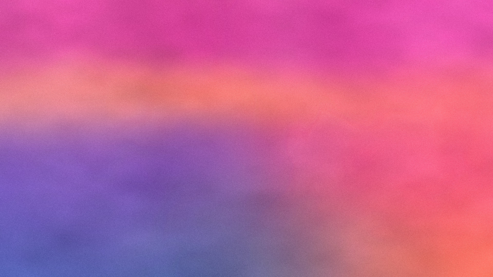
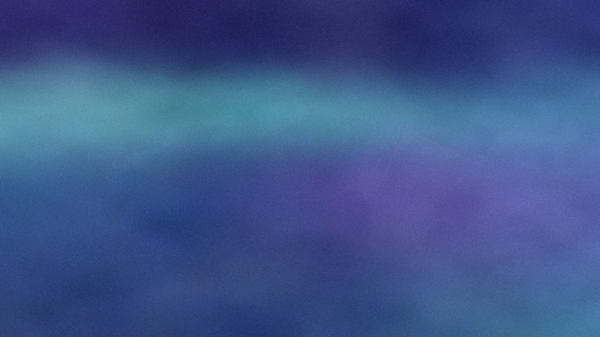
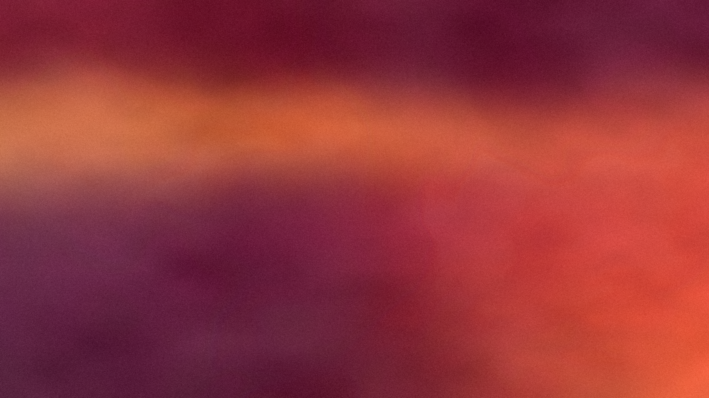
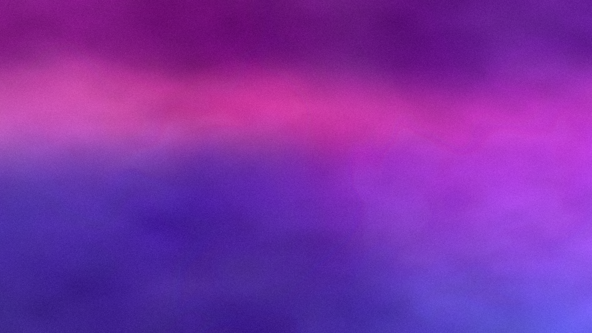
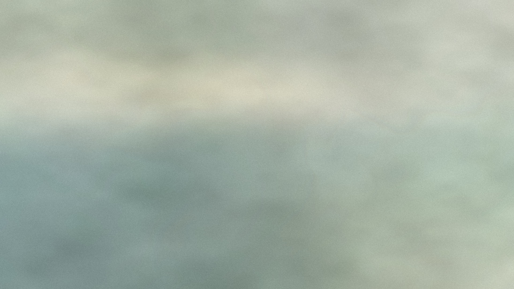

# Fluid Gradient Wallpapers — Pure Code

Deep, heavy, grainy gradient wallpapers generated **entirely from code** — no image
editors, no external libraries, no downloaded textures. Every pixel is computed
mathematically and encoded into a PNG by a hand-written encoder.

All designs are **3840 × 2160 (4K)**.

---

## The Gallery

| # | Design | Theme |
|---|--------|-------|
| 00 |  | **Signature Heavy Gradient** — deep magenta, orange band, purple/blue lower field |
| 01 |  | **Aurora Night** — indigo, violet and a luminous mint-teal current |
| 02 |  | **Ember Silk** — molten crimson, burnt orange and gold |
| 03 |  | **Ocean Glass** — deep navy, cerulean and frosted aqua |
| 04 |  | **Neon Dusk** — electric magenta, violet and blue |
| 05 |  | **Sage Mist** — soft sage, cream and muted teal |

Small previews are in `images/preview-*.png` for quick loading.

---

## How the design is achieved (the full method)

The image is **not drawn** — it is evaluated per pixel. For each pixel at
normalized coordinates `u = x/W`, `v = y/H` the renderer runs a stack of layers
from bottom to top:

```
 1. OKLab mesh-gradient color field (domain-warped, blobs carry internal gradients)
 2. Soft-focus blur (second offset sample averaged in)
 3. Asymmetric left/right glow gradients
 4. Misty haze veil
 5. Ultra-thin iridescent oil film (real thin-film interference)
 6. Grainy substance (super-fine, super-dense, multi-scale)
 7. Grainy glass layer (frost, blur smudge, woven texture, bright specks)
```

### 1. OKLab mesh-gradient — the heart of the gradient

A set of elliptical color "sources" each contributes a Gaussian weight:

```
w = strength · exp( -1.5 · [ ((u−cx)/sx)² + ((v−cy)/sy)² ] )
final = Σ(w · color) / Σw
```

Crucially, the blend happens in **OKLab** space, not RGB. Perceptual blending
keeps transitions vivid — a blue→pink blend passes through clean purples instead
of dead grey. Each source color is converted to OKLab once at startup:
`sRGB → linear → LMS → cbrt → (L,a,b)`, then converted back with the inverse
matrix and sRGB encoding after blending.

Each blob also carries a small **internal gradient vector** (`g`), so even a
region that looks like a solid color is subtly gradiented across its own width.

### 2. Three-stage domain warp — liquid, non-geometric flow

Before sampling the color field, the coordinate grid itself is bent:

```
q = fbm(p)                    // first warp field
r = fbm(p + 2.2·q)            // second warp, sampled through q
f = fbm(p + 2.4·r)            // final field, sampled through r
u' = u + 0.055(qx−.5) + 0.045(rx−.5) + 0.030(f−.5)
v' = v + 0.055(qy−.5) + 0.045(ry−.5) + 0.026(f−.5)
```

This is the key trick: because the *sampling position* is displaced by smooth
fractal noise, straight color boundaries become flowing, liquid curves with no
geometric character. FBM uses a rotated lacunarity matrix (`1.6x+1.2y`,
`−1.2x+1.6y`) so noise is not axis-aligned.

The warp fields are computed once at quarter resolution and bilinearly sampled,
which keeps a 4K render at roughly 20–30 seconds.

### 3. Soft-focus blur

A second copy of the color field is sampled at a small offset
(`u+0.02, v+0.016`) and averaged in at ~40%. This is a cheap, genuine blur that
removes any remaining hard transitions and gives the "heavy, out-of-focus" feel.

### 4. Asymmetric side glows

Two wide Gaussians at the left and right edges add a gentle luminous falloff.
They are deliberately *not* identical — the left is 0.255 wide at 0.50 strength,
the right is 0.282 wide at 0.55 — producing the subtle natural asymmetry the
style needs.

### 5. Misty haze veil

A low-frequency FBM field, remapped with a smoothstep, screens a very faint
warm-white veil over the image (opacity 8–18% depending on theme).

### 6. Ultra-thin glowing oil film

A genuine thin-film interference calculation. Film thickness `d` (180–1080 nm)
comes from the warped FBM field, then per-channel reflectances are:

```
R = 0.5 − 0.5·cos(2π · 2·n·d / λ)    n = 1.47
λ = (650, 532, 450) nm for R, G, B
```

This is mixed in at only ~2.5–4% — almost invisible on its own, but it adds the
faint iridescent sheen that makes the surface feel real.

### 7. Grainy substance + grainy glass (the texture stack)

Grain is built from **three frequencies at once**, deliberately weighted so the
larger grains dominate:

```
grain = 0.24·noise(1024 grid)
      + 0.22·noise(2048 grid)
      + 0.18·noise(4096 grid)
      + 0.36·white noise (one grain per pixel)
```

A second, lower-intensity layer is sampled with reversed coordinates to mimic
the way real film grain stacks in depth. Amplitude is luminance-dependent
(stronger in shadows), matching real film.

The final **glass** layer adds:
- multi-octave frost modulation (8/16/32 grids)
- a soft "blur smudge" from low-frequency noise
- a fine diagonal woven movie-filter texture (`sin(u+v)·sin(u−v)` at high frequency)
- sparse bright wet highlights, with dark specks deliberately omitted so the
  result stays clean rather than dirty

### 8. Hand-written PNG encoder

No libraries: scanlines are written with filter byte 0, deflated with Node's
`zlib.deflateSync`, and wrapped in `IHDR` / `IDAT` / `IEND` chunks with a
CRC32 table computed at startup. The RNG is a fixed-seed mulberry32 variant, so
every render is perfectly reproducible.

---

## Files

```
render-pro.js       parameterized engine + all 5 theme definitions
build-all.js        renders every theme at 4K in one command
images/             the 4K wallpapers + small previews
```

## Regenerate

```bash
# one design
node render-pro.js aurora 3840 2160 images/01-aurora-night.png

# all five at 4K
node build-all.js

# available themes
aurora  ember  ocean  neon  sage
```

## How this was developed

The design was iterated from a rough approximation to the final version by
tightening one property at a time: clean color field → visible-but-soft fold →
dissolved curve → super-fine dense grain → enlarged 4K/8K canvas → removal of
all dark/dirty areas → soft-focus blur → finally, deep heavy gradients with no
curves at all. Each iteration is preserved as a numbered version in the
workspace; this repository contains the refined, generalized engine.


---
*Repository history rewritten to a single commit attributed to DERYK-RYLOY.*
